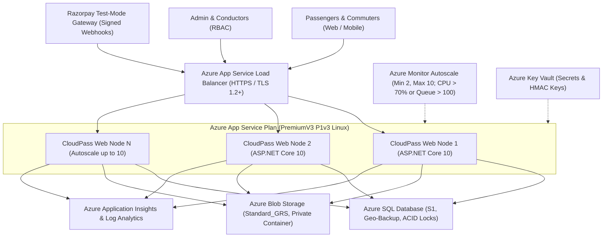

# CloudPass Cloud Architecture, Scalability & Security Guide

**Tagline:** *"Your Journey. Your Ticket. Always Connected."*

CloudPass is architected to demonstrate how modern **Microsoft Azure cloud computing** and **application cybersecurity** solve the structural weaknesses of traditional bus booking systems (paper ticket loss, QR forgery, seat double-booking, client-side fare tampering, and peak-hour server outages).

---

## 1. High-Level Azure Cloud Architecture

---

## 2. Dynamic Horizontal Autoscaling (`infra/azure/main.bicep`)

| Parameter | Configuration | Purpose |
|---|---|---|
| **App Service Plan SKU** | `P1v3` (PremiumV3 Linux) | Dedicated vCPU/RAM with production autoscale and zone resilience |
| **Minimum Instances** | `2` | Eliminates single point of failure (High Availability baseline) |
| **Maximum Instances** | `10` | Absorbs 5x traffic spikes automatically |
| **Scale-Out Rule 1 (CPU)** | Avg CPU `> 70%` for `5 min` -> `+2 instances` (5m cooldown) | Rapidly expands compute during heavy search/checkout peaks |
| **Scale-Out Rule 2 (Load)** | Avg `HttpQueueLength > 100` for `5 min` -> `+1 instance` | Reacts to request queuing before latency degrades |
| **Scale-In Rule** | Avg CPU `< 30%` for `10 min` -> `-1 instance` (10m cooldown) | Reclaims cloud cost smoothly during off-peak overnight hours |

### High-Traffic Management Controls
1. **Stateless Load-Balanced Web Tier** with encrypted cookies and centralized Azure SQL state.
2. **In-Memory Caching (`IMemoryCache`)** for popular routes and city lists.
3. **Composite SQL Indexes** on routes, schedules, and seats.
4. **Connection Pooling + EF Core Transient-Fault Retry** (`EnableRetryOnFailure(5, 15s)`).
5. **Bounded Async Queue (`Channel<T>` + `QueuedHostedService`)** for PDF generation and cloud blob uploads.
6. **ASP.NET Core Rate Limiting** on `auth`, `verify`, and `api` routes.

---

## 3. Ticket Security & Fraud Prevention Controls

1. Unique cryptographic booking & pass references (`CP-YYYYMMDD-XXXXXX`, `CPP-YYYYMM-XXXXXX`).
2. Constant-time **HMAC-SHA256** signed verification tokens (`CP1.TKT.<Ref>.<Nonce>.<HMAC>`).
3. **Zero-PII QR codes** encoding only the signed verification URL.
4. **Single-use boarding lock** (`IsUsed = true`) blocking duplicate QR reuse (`ALREADY_USED`).
5. **PBKDF2** salted password hashing + Cookie Auth + RBAC (`[Authorize(Roles = "Admin")]`).
6. **Zero-trust server-side fare validation** rejecting tampered prices (`PRICE_TAMPERING_BLOCKED`).
7. **Atomic conditional SQL seat locking** (`WHERE IsBooked = 0`) inside explicit transactions.
8. **Strict IDOR ownership enforcement** on every ticket, PDF, pass, and cancellation route.
9. **Signed payment & webhook verification** (`X-Razorpay-Signature` HMAC-SHA256).
10. **Immutable `AuditLogs` & `TicketVerifications`** tables for forensic traceability.
