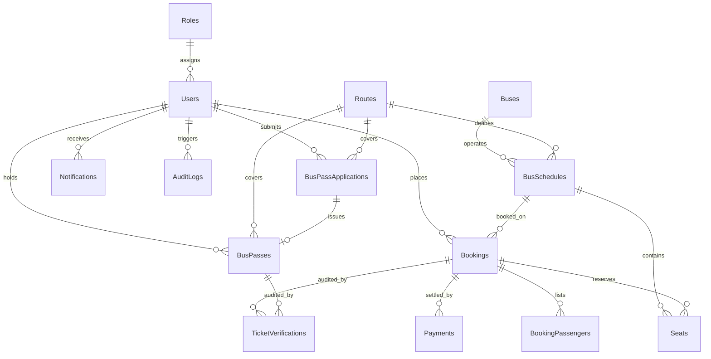

# CloudPass Database Design & ER Documentation

CloudPass uses a normalized 14-table relational database engineered with **Entity Framework Core** and designed for **Microsoft Azure SQL Database** (with automatic SQLite local development support).

## 1. Entity-Relationship (ER) Diagram



## 2. Table Catalog (14 Core Tables)

| # | Table | Purpose | Key Constraints & Indexes |
|---|---|---|---|
| 1 | `Roles` | Role definitions (`Admin`, `User`) | `UK(Name)` |
| 2 | `Users` | Registered commuters and administrators with PBKDF2 password hashes | `UK(Email)`, `FK(RoleId)` |
| 3 | `Buses` | Fleet registry (AC/Non-AC, Sleeper/Seater, capacity, amenities) | `UK(BusNumber)` |
| 4 | `Routes` | Inter-city transit corridors and authoritative base pricing/fees/taxes | `IX(SourceCity, DestinationCity)` |
| 5 | `BusSchedules` | Scheduled trips linking Buses and Routes with official seat fares | `IX(RouteId, JourneyDate, Status)`, `IX(DepartureTime)`, `ConcurrencyStamp` |
| 6 | `Seats` | Per-schedule seat inventory with deck/position and atomic lock flags | `UK(BusScheduleId, SeatNumber)`, `IX(BusScheduleId, IsBooked)`, `ConcurrencyStamp` |
| 7 | `Bookings` | Transactional bookings with server-verified totals & signed QR token hashes | `UK(BookingReference)`, `IX(UserId, BookingStatus)`, `IX(TicketTokenHash)`, `ConcurrencyStamp` |
| 8 | `BookingPassengers` | Per-seat passenger manifest attached to each booking | `FK(BookingId)` cascade delete |
| 9 | `Payments` | Payment gateway orders, HMAC signatures, and webhook verification flags | `UK(GatewayOrderId)`, `FK(BookingId)` |
| 10 | `BusPassApplications` | Commuter pass applications & renewal requests awaiting admin review | `UK(ApplicationReference)`, `IX(UserId, Status)` |
| 11 | `BusPasses` | Issued digital passes with validity dates and signed QR verification hashes | `UK(PassNumber)`, `UK(ApplicationId)`, `IX(UserId, Status)`, `IX(VerificationTokenHash)` |
| 12 | `TicketVerifications` | Immutable audit trail of every QR scan (valid, forged, cancelled, reused) | `IX(VerifiedAt)`, `FK(BookingId)`, `FK(BusPassId)` |
| 13 | `Notifications` | In-app notifications for booking, payment, ticket, cancellation, and pass lifecycle | `IX(UserId, IsRead, CreatedAt)` |
| 14 | `AuditLogs` | Immutable security and admin action log | `IX(Timestamp)`, `FK(UserId)` |

## 3. EF Core SQL Server Migrations

```bash
dotnet tool install --global dotnet-ef
dotnet ef migrations add InitialCloudPassSchema --project src/CloudPass.Infrastructure --startup-project src/CloudPass.Web --output-dir Migrations
dotnet ef database update --project src/CloudPass.Infrastructure --startup-project src/CloudPass.Web
```
